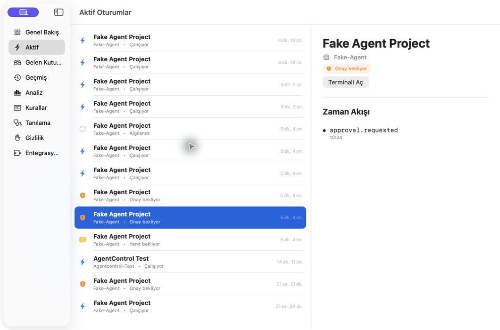

# yusufiwt

A native macOS app for keeping track of AI coding agents, responding to their requests, and returning to the right workspace.

When several agents are working across different projects, yusufiwt brings their activity into a menu bar, a notch-style floating panel, and a Control Center. See which sessions are running, which need your input, and which have finished without checking every terminal or editor.

The current product scope is **Mac Local V1**. It runs on your Mac without a yusufiwt account or a hosted service. The interface supports English and Turkish.



*Example interface with simulated agent sessions.*

## What it does

- **Track sessions across projects.** Follow agent activity, session states, and parent/subagent relationships in one place.
- **Handle requests for input.** Approve or deny actions, answer questions, and review plans when the connected provider supports those capabilities.
- **Surface events that need attention.** Use the inbox, local notifications, and configurable sound and quiet-hour settings.
- **Return to your work.** Open the associated terminal, supported editor, project folder, or Codex desktop chat.
- **Understand usage.** View provider-reported account quota, conversation context, and token counters as separate measurements. Missing data is shown as unavailable.
- **Manage integrations locally.** Preview, install, repair, and remove managed provider hooks, with backups and changes scoped to yusufiwt-owned entries.
- **Review local history.** Inspect session history, analytics, automation rules, and redacted diagnostics from the Control Center.

## Supported integrations

| Provider | Integration |
| --- | --- |
| Codex | Managed hooks, local transcript discovery, desktop chat navigation, and optional stop requests through the local desktop relay. |
| Claude Code | Managed hooks and local transcript discovery. |
| Gemini CLI | Managed hooks for session events and supported decisions. |
| Cursor | Managed hooks, supported tool decisions, context usage, and IDE navigation. |

Capabilities depend on the provider version and connection. Transcript discovery is monitor-only; decisions require a supported hook or control connection. Cursor Agent questions and plan review are currently unsupported. See the [compatibility matrix](Docs/ADAPTER_COMPATIBILITY.md) for supported versions and decision types.

## Getting started

### Requirements

- **To run:** macOS 14 or newer, on Apple Silicon or Intel.
- **To build:** full Xcode, the Swift toolchain, Homebrew, and `make`. The repository specifies Xcode 26.6 and Swift 6.3.3 in [.tool-versions](.tool-versions).

### Build and install

```sh
git clone https://github.com/ysfyrdmcl/yusufiwt.git
cd yusufiwt
make bootstrap
make generate
make test-mac-local
make package-mac-local
```

`make bootstrap` installs missing XcodeGen, SwiftFormat, and SwiftLint tools through Homebrew. Packaging produces `dist/yusufiwt.app` and `dist/yusufiwt-macOS-local-v1.zip`; generated artifacts are kept out of Git.

Install the locally built app with:

```sh
make install-mac-local
```

The default build uses ad-hoc signing. If macOS blocks the first launch, use Finder's **Control-click → Open** flow. See the [installation guide](Docs/MAC_LOCAL_V1_INSTALL.md) for signing details, upgrades, recovery, and uninstallation.

### Connect your agents

1. Open yusufiwt and complete the initial setup, including background activity and notification permissions when requested.
2. Open **Control Center → Integrations** to preview and install the hooks for your providers. Codex and Claude Code also support local session discovery without hooks.
3. Start an agent session and follow it from the menu bar or floating panel. Open the Control Center for requests, integrations, history, and settings.

For Codex desktop stop requests, yusufiwt needs a local relay connection. It can start Codex with the relay or offer to reopen an existing instance after your ongoing work is finished. Monitoring remains available if you decline.

## How it works

Provider hooks send structured events to a background helper running as the same macOS user. The helper maintains session state and local SQLite history, evaluates rules, and supplies the SwiftUI/AppKit interface through authenticated XPC. Codex and Claude Code transcript discovery provides an additional source of session metadata.

Decisions return through the provider integration. A request is shown as applied only after the provider acknowledges it, and controls are available only for supported capabilities.

## Privacy

- Session history and analytics are processed locally. Mac Local V1 disables telemetry and remote services.
- Prompt and terminal-output storage are disabled by default. Transcript discovery uses bounded session metadata without persisting message content.
- Integrations use structured events rather than screen capture. Some terminal-navigation features may require opt-in Automation or Accessibility permission.
- Diagnostic exports redact credential-shaped values and user home paths before writing the export.

Read the [privacy documentation](Docs/PRIVACY.md) and [security policy](SECURITY.md) for the data handling and reporting details.

## Project scope

Mac Local V1 covers the macOS app, local helper, provider integrations, local decisions, history, diagnostics, and notifications.

The repository also contains iOS and watchOS companions, widgets, Live Activities, an encrypted relay, APNs integration, and Sparkle update support. These are preserved for V2 and are **outside the current Mac Local V1 build and runtime scope**. The desktop app currently targets macOS.

The [Mac Local V1 scope](Docs/MAC_LOCAL_V1_SCOPE.md) describes the current product boundary. The [project plan](yusufiwt_PROJECT_PLAN.md) records the broader roadmap.

## Development

After bootstrapping and generating the Xcode project:

```sh
make test                  # Contract, Swift, and Xcode tests
make lint                  # Formatting and lint checks
make verify-mac-local-v1    # Package and verify the local release
```

Useful local tools:

```sh
swift run agentcontrol-hook doctor
swift run fake-agent-simulator approval --auto-decision approve
swift run protocol-inspector pending
```

See [CONTRIBUTING.md](CONTRIBUTING.md) for the contribution workflow.

## Documentation

| Guide | Contents |
| --- | --- |
| [Installation](Docs/MAC_LOCAL_V1_INSTALL.md) | Build, install, upgrade, and troubleshoot the local app. |
| [Current scope](Docs/MAC_LOCAL_V1_SCOPE.md) | Features included in Mac Local V1 and work deferred to V2. |
| [Provider compatibility](Docs/ADAPTER_COMPATIBILITY.md) | Supported provider versions and capabilities. |
| [Architecture](Docs/ARCHITECTURE.md) | Modules, local communication, persistence, and trust boundaries. |
| [Privacy](Docs/PRIVACY.md) | Local data handling, retention, and diagnostic exports. |
| [Security](SECURITY.md) | Security guarantees and private vulnerability reporting. |

## License

Copyright © 2026 Yusuf Yardimciel. All rights reserved. See [LICENSE](LICENSE) for usage terms.
